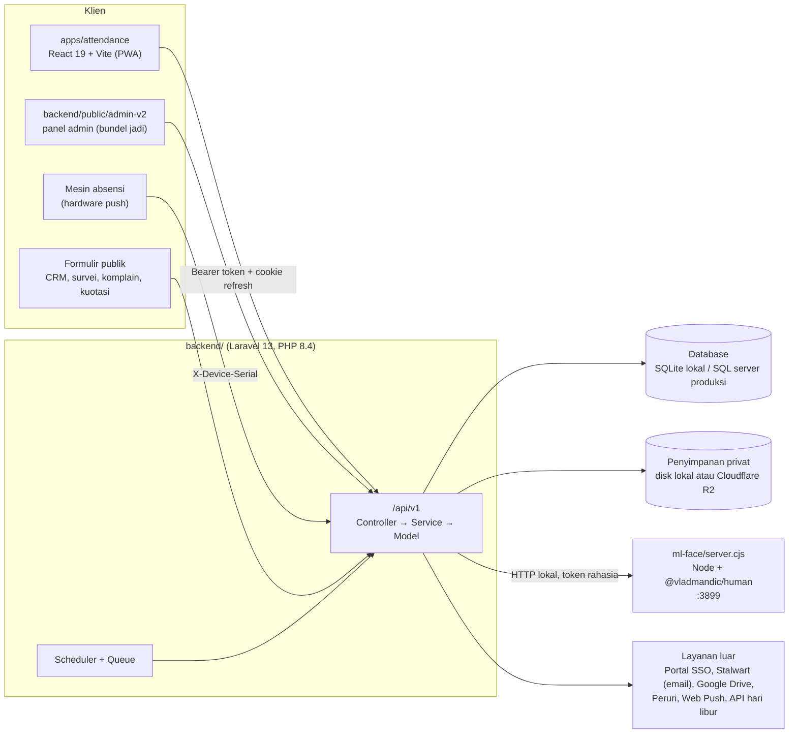
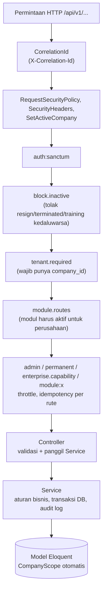
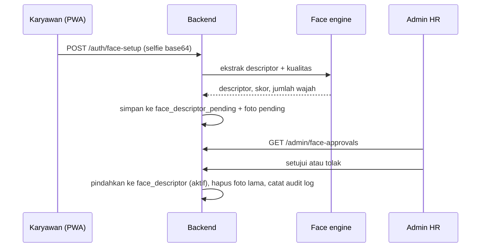

# Arsitektur Sistem

Dokumen ini menjelaskan bagaimana IBE HRIS tersusun, bagaimana sebuah permintaan mengalir dari layar karyawan sampai ke database, dan di mana aturan bisnis penting berada. Isinya disusun dari pembacaan kode pada paket `main` per 20 Oktober 2026. Bila kode berubah, dokumen ini perlu ikut diperbarui. Untuk skema tabel, lihat [DATA_MODEL.md](DATA_MODEL.md).

## 1. Gambaran umum

IBE HRIS pada dasarnya adalah **satu API Laravel multi-tenant** yang dilayani oleh satu **aplikasi React** untuk karyawan dan admin HR, ditambah satu **layanan pengenal wajah** terpisah. Backend yang sama juga memuat modul ERP lain (keuangan, CRM, produksi, gudang, persuratan) yang berbagi tabel pengguna, tenant, dan sistem hak akses dengan modul HR.



Hal yang perlu dipahami sejak awal:

- **Tenant adalah perusahaan.** Hampir semua tabel punya `company_id`, dan setiap permintaan terautentikasi otomatis dibatasi ke perusahaan penggunanya.
- **Hak akses berlapis.** Ada peran bawaan (`users.group`), kapabilitas turunannya, mesin RBAC "enterprise" yang berjalan berdampingan, dan lisensi modul per perusahaan.
- **Wajah adalah data biometrik.** Template wajah disimpan di database sendiri, tidak dikirim ke pihak ketiga pada konfigurasi produksi, dan setiap pendaftaran wajah harus disetujui admin sebelum dipakai.
- **Pola kode utama:** Controller tipis → Service → Model. Aturan bisnis diletakkan di `app/Services/`.

## 2. Struktur repositori

```
IBE-HRIS-dev/
├── README.md                  Panduan masuk (setup, menjalankan, aturan)
├── CLAUDE.md                  Konteks ringkas untuk asisten AI
├── setup-lokal.ps1            Setup otomatis Windows
├── docs/                      Dokumentasi (dokumen ini)
├── backend/                   API Laravel + modul ERP
│   ├── app/
│   │   ├── Http/Controllers/Api/V1/   97 controller (HR, auth, RBAC, dsb.)
│   │   ├── Http/Middleware/           17 middleware (tenant, hak akses, keamanan)
│   │   ├── Services/                  69 service: logika bisnis HR/inti
│   │   ├── Models/                    134 model Eloquent
│   │   ├── Keuangan/  Marketing/  Production/  Produksi/  Surat/  Warehouse/
│   │   │                              modul ERP, masing-masing punya Controllers/Models/Services
│   │   ├── Console/Commands/          22 perintah artisan
│   │   ├── Scopes/CompanyScope.php    filter tenant global
│   │   └── Traits/BelongsToCompany.php
│   ├── routes/ api.php  api/*.php  web.php  private_media.php  console.php
│   ├── config/                        face, enterprise_rbac, saas_modules, features, sso, ...
│   ├── database/ migrations (214)  seeders  factories
│   ├── ml-face/server.cjs             layanan pengenal wajah (Node)
│   ├── public/admin-v2/               panel admin hasil build (tanpa sumber di paket ini)
│   ├── resources/views/               Blade: PDF, email, kontrak, surat
│   └── tests/Feature/Api/             suite uji Pest
└── apps/attendance/           Aplikasi React karyawan + admin HR
    └── src/ api/ components/ context/ hooks/ lib/ pages/ pages/admin/ pages/employee/ types/ utils/
```

## 3. Backend

### 3.1 Alur sebuah permintaan



Urutan middleware di atas bersumber dari `bootstrap/app.php` (alias dan grup `api`) dan `routes/api.php` (grup rute terlindungi). Beberapa catatan:

- `throttle` di proyek ini adalah `ThrottleRequestsPerRoute`, yaitu penghitung per rute, bukan satu penghitung bersama per IP.
- Setiap respons membawa `X-Correlation-Id`, termasuk respons galat autentikasi, sehingga kegagalan bisa dilacak.
- Rute yang mengubah data keuangan atau alur kerja memakai middleware `idempotency` (header `Idempotency-Key`, berlaku 24 jam, disimpan di `api_idempotency_keys`).
- Berkas rute dipecah: `routes/api.php` (utama, sekitar 1.200 baris), `routes/api/projects.php`, `routes/api/erp_admin.php`, `routes/api/erp_protected.php`, serta `routes/private_media.php` untuk berkas bertanda tangan.

### 3.2 Pembagian kode

| Lapisan | Lokasi | Peran |
|---|---|---|
| Controller | `app/Http/Controllers/Api/V1/` | Validasi input, memanggil service, membentuk respons. Dibuat setipis mungkin. |
| Resource | `app/Http/Resources/` | Bentuk JSON keluaran (`UserResource`, `AttendanceResource`, dst.). |
| Service | `app/Services/` | Aturan bisnis: absensi, payroll, cuti, wajah, RBAC, penyimpanan privat, SSO, dll. |
| Model | `app/Models/` | Eloquent. Model bertenant memakai `BelongsToCompany` / `CompanyScope`. |
| Modul ERP | `app/Keuangan`, `Marketing`, `Production`, `Produksi`, `Surat`, `Warehouse` | Masing-masing membawa Controller, Model, dan Service sendiri. |
| Perintah terjadwal | `app/Console/Commands/`, `routes/console.php` | Pengingat, sinkronisasi email, kampanye CRM, pembersihan tabel. |

Dua direktori bernama mirip, `Production` (MRP, BOM, PO, stok) dan `Produksi` (work order vendor, pelacakan progres vendor), adalah modul yang berbeda. Rute pelacakan vendor di `Produksi` hanya didaftarkan bila `FEATURE_VENDOR_TRACKING=true`.

### 3.3 Multi-tenancy

- `CompanyScope` menambahkan `WHERE company_id = <perusahaan aktif> OR company_id IS NULL` ke setiap kueri model bertenant. Baris dengan `company_id` kosong dianggap **data global** (misalnya master pendidikan atau hari libur nasional) yang terlihat oleh semua tenant.
- Perusahaan aktif ditentukan oleh `SetActiveCompany` dan `RequireTenantContext` dari `users.company_id`. Akun tanpa `company_id` ditolak dengan 403.
- Klien tidak pernah memilih tenant sendiri; tenant selalu berasal dari akun yang login.
- Kode yang perlu menembus scope (misalnya cek geofence, kueri lintas perusahaan) memakai `withoutGlobalScopes()` dan harus menyaring `company_id` secara eksplisit. Lihat `AttendanceService::checkGeofence` sebagai contoh.

### 3.4 Autentikasi dan sesi

1. **Login** `POST /api/v1/auth/login` menerima `identifier` (email, email lama, NIP, nomor HP, atau nomor pegawai) dan `password`. Akun nonaktif ditolak sebelum token terbit.
2. Bila **2FA** aktif, respons berisi tantangan dan token baru terbit setelah `POST /auth/two-factor-challenge` berhasil.
3. Respons berisi **token akses Sanctum** (kedaluwarsa menurut `SANCTUM_EXPIRATION`, bawaan 60 menit) dan cookie **refresh** HttpOnly. Kemampuan token: `['admin','employee']` untuk peran admin, `['employee']` untuk lainnya.
4. Klien memperbarui token lewat `POST /auth/refresh`. Refresh token berotasi; pemakaian ulang token yang sudah terpakai mencabut seluruh rantai (`RefreshTokenService`).
5. `logout` hanya mencabut sesi perangkat ini; `logout-all` mencabut semua token pengguna.
6. **SSO portal.** Portal (`portal.ibereality.com`) menerbitkan tiket sekali pakai yang ditukar di `/auth/sso/exchange` (lihat `SsoService`, `config/sso.php`). Di server, aplikasi absensi berjalan dengan `VITE_REQUIRE_SSO=true`; di laptop pengembang SSO dimatikan.
7. Throttle login berlapis: per IP, dan per kombinasi akun+IP (`RateLimiter` di `AppServiceProvider` dan `FortifyServiceProvider`).

Di sisi klien (`apps/attendance/src/api/client.ts`): token disimpan di `localStorage` (`absen_token`), dikirim sebagai `Bearer`, dan ketika menerima 401 klien memperbarui token satu kali dengan antrean tunggal sebelum mencoba ulang. Gagal refresh memicu peristiwa `auth:force-logout`. `AuthContext` juga menerapkan batas diam 60 menit dengan peringatan 5 menit sebelumnya.

### 3.5 Otorisasi

Ada empat lapisan yang bekerja bersama. Memahami urutannya penting sebelum menambah fitur.

| Lapisan | Mekanisme | Keterangan |
|---|---|---|
| 1. Peran bawaan | `users.group`: `user`, `admin`, `superadmin`, `finance`, `produksi`, `direktur`, `marketing` | Ditambah peran tambahan di tabel `user_roles` (multi-peran). Peran tambahan hanya menambah kapabilitas yang dibatasi; saat ini `marketing` adalah satu-satunya yang diperlakukan khusus. |
| 2. Kapabilitas | `User::capabilities()` memetakan peran ke daftar string seperti `attendance.manage`, `payroll.approve`, `crm.view` | Dicek lewat `User::hasCapability()` dan middleware `admin` (butuh `admin.access`). |
| 3. RBAC enterprise | `EnterpriseAuthorizationService`, tabel `rbac_*`, middleware `enterprise.capability:<cap>,<legacy>` | Mode `ENTERPRISE_RBAC_MODE`: `legacy`, `shadow` (bawaan; keputusan lama berlaku, keputusan baru hanya dicatat), `enforce` (kebijakan baru berlaku). Mendukung penugasan berjangka waktu, cakupan, batas persetujuan, dan delegasi. |
| 4. Lisensi modul | `ModuleEntitlementService`, `ModuleRouteManifest`, middleware `module.routes` dan `module:<key>`, `config/saas_modules.php` | Modul: `people`, `marketing`, `sales`, `finance`, `treasury`, `production`, `distribution`, `warehouse`, `procurement`. Respons 403 dengan kode `MODULE_NOT_ENABLED` bila modul tidak aktif. |

Aturan tambahan di tingkat rute dan layanan:

- Middleware `permanent` membatasi cuti, lembur, kasbon, slip gaji, dan perjalanan dinas untuk **karyawan tetap** (`employment_status = permanent`). Admin lolos.
- Pemisahan tugas pada keuangan: HR dapat mengajukan payroll (`payroll.submit`), sementara persetujuan dan pembayaran dipegang `finance` (`payroll.approve`, `payroll.pay`). Hal serupa berlaku pada kasbon dan reimbursement dua tahap, dan diuji di `SalaryAdvanceSeparationOfDutiesApiTest`.
- Proyek memakai `ProjectAuthorizer` untuk hak per proyek (peran anggota: termasuk `viewer`).
- Frontend mencerminkan hak akses lewat `<AdminRoute capability="...">` di `App.tsx`. Ini hanya kenyamanan tampilan; **penegakan sebenarnya ada di backend**.

### 3.6 Alur absensi dan verifikasi wajah

**Pendaftaran wajah** (sekali, atau saat memperbarui):



**Absen masuk** (`AttendanceController::clockIn` → `AttendanceService::clockIn`):

```mermaid
sequenceDiagram
    participant K as Karyawan
    participant B as Backend
    participant F as Face engine
    K->>B: POST /attendances/clock-in (selfie, GPS, device_id)
    B->>B: cek geofence (kecuali mode mobile_field)
    B->>B: validasi bukti lokasi untuk mobile_field
    B->>F: bandingkan selfie dengan descriptor aktif
    F-->>B: similarity, liveness, antispoof
    B->>B: tolak bila tidak cocok; tandai atau tolak bila liveness rendah
    B->>B: tentukan shift dan status (present, late, off_shift)
    B->>B: transaksi: buat Attendance, simpan selfie ke penyimpanan privat
    B-->>K: data absensi
```

Aturan yang tertanam di kode (sumber: `AttendanceService`, `FaceVerificationService`, `config/face.php`):

- **Shift.** Dicari berurutan: (1) jadwal harian di `shift_mappings`, (2) shift bawaan pengguna (`users.default_shift_id`), (3) shift otomatis per jabatan (`auto_shifts`), (4) shift bawaan divisi, (5) shift pertama milik perusahaan. Jendela absen sah adalah `[mulai shift − 60 menit, selesai shift + 60 menit]`; di luar itu statusnya `off_shift`.
- **Terlambat.** Lewat masa toleransi (`shifts.grace_period_minutes`, lalu bawaan perusahaan, lalu 15 menit) status menjadi `late`. `late_minutes` dihitung dari jam mulai shift, bukan dari akhir toleransi, agar sesuai tingkat potongan di payroll.
- **Geofence.** Bila perusahaan punya lokasi kantor aktif, koordinat harus berada dalam radius salah satunya. Tanpa lokasi kantor, geofence tidak aktif. Mode `mobile_field` (untuk sales lapangan) melewati geofence tetapi mewajibkan koordinat segar dengan akurasi ≤ 100 m, `device_id`, dan pemeriksaan perpindahan tidak wajar (> 10 km dengan kecepatan > 250 km/jam ditahan).
- **Wajah.** Pengguna tanpa descriptor aktif tidak bisa absen; pesan galat membedakan "belum daftar" dan "menunggu persetujuan". Ambang kecocokan `FACE_MATCH_SIMILARITY_THRESHOLD` (bawaan 0,60).
- **Liveness dan antispoof.** `FACE_LIVENESS_MODE=shadow` (bawaan) hanya mencatat skor dan memberi tanda untuk HR (`liveness_low`, `antispoof_low`, `multi_face`, `borderline`, `small_face`); `enforce` menolak absen di bawah ambang. Skor disimpan di kolom pemeriksaan wajah pada absensi, tanpa data biometrik mentah.
- **Absensi manual oleh admin** (`createManualEntry`, `updateManualEntry`) melewati wajah dan geofence, mencatat alasan, dan menulis audit log.
- **Mesin absensi** mengirim data ke `POST /hardware/push` dengan header `X-Device-Serial`; nomor seri di `attendance_devices` menjadi identitasnya, dan tanda tangan push wajib bila `HARDWARE_PUSH_REQUIRE_SIGNATURE=true`.

### 3.7 Layanan pengenal wajah

`backend/ml-face/server.cjs` adalah proses Node terpisah yang memuat model `@vladmandic/human` dan membuka tiga titik akhir lokal: `GET /health`, `POST /extract`, `POST /compare`. Laravel memanggilnya lewat `FaceEngineClient` dengan token rahasia (`FACE_ENGINE_TOKEN`, header `x-face-engine-token`). Pemilihan driver ada di `app/Services/Face/`: `HumanFaceDriver` (dijalankan sendiri, untuk produksi) dan `BiznetFaceDriver` (hanya demo, karena mendaftarkan biometrik ke pihak ketiga sebelum persetujuan admin). Layanan ini sebaiknya hanya mendengarkan `127.0.0.1` dan dijalankan sebagai proses yang otomatis hidup ulang (contoh unit systemd ada di `backend/README.md`).

Aplikasi React juga memuat `@vladmandic/face-api` (detektor ringan `tiny_face_detector` di `apps/attendance/public/models`) pada halaman `AttendancePage` dan `FaceSetupPage` untuk mendeteksi keberadaan wajah di kamera sebelum selfie dikirim. Keputusan kecocokan tetap diambil backend. `utils/faceCheck.ts` hanya memuat tipe dan label tanda peninjauan yang ditampilkan kepada admin.

### 3.8 Payroll

`PayrollService::calculate(user, bulan, tahun)` menghasilkan satu baris `payrolls` per karyawan per periode. Masukannya:

- Rekap absensi periode itu (hadir, terlambat, tidak hadir, cuti), jumlah hari kerja, dan hari libur (API hari libur bila `HOLIDAY_API_ENABLED=true`, dengan cache 6 jam).
- Lembur berstatus `approved` (jam × `overtime_rate`).
- Reimbursement berstatus `approved` (`approved_amount`).
- Tarif per karyawan di tabel `users` (`salary_monthly`, `meal_transport_rate`, `attendance_allowance`, `late_deduction`, `absent_deduction`, `leave_deduction`, `bonus_rate`, `thr_allowance`) dengan cadangan ke tunjangan golongan (`allowances`).
- Potongan keterlambatan bertingkat dari `late_deduction_tiers` bila ada.
- Saldo dan cicilan kasbon.

Aturan status kepegawaian: **training** dibayar `daily_rate × hari hadir` hanya di dalam rentang training; **probation** dibayar separuh `salary_monthly`; status lain dibayar penuh. Bonus kehadiran mengikuti ambang di tabel `companies` (`attendance_bonus_min_present`, `attendance_bonus_max_late`), yang tercermin dari pasal kontrak kerja.

Siklus status payroll: `draft → submitted → approved → paid`. Tabel `payrolls` juga menyimpan bukti transfer dan terhubung ke jurnal akuntansi (`fin_journals`) melalui migrasi `link_payrolls_to_journal`. Slip gaji dirender menjadi PDF dengan DomPDF (`PayrollDocumentService`) dan dapat dikirim lewat email; batas memori dan ukuran gambar diatur oleh `PDF_*` di `.env`.

### 3.9 Penyimpanan berkas privat

Foto selfie absensi, lampiran reimbursement, foto wajah, tanda tangan kontrak, dan lampiran proyek tidak diletakkan di folder publik. `PrivateMediaStorage` dan service turunannya menyimpan berkas beserta **checksum SHA-256, ukuran, dan dimensi** di kolom model. Pengambilan lewat dua jalur di `routes/private_media.php`: rute terautentikasi, dan **URL bertanda tangan** berumur pendek (contohnya 5 menit untuk foto wajah). Penyimpanan dapat berupa disk lokal atau Cloudflare R2 (`R2_*`, `PROJECT_ATTACHMENTS_REQUIRE_R2`). Beberapa perintah `*Cutover*` di `app/Console/Commands` ada untuk memindahkan berkas lama ke skema privat ini.

### 3.10 Hal lintas-modul

| Kemampuan | Lokasi | Catatan |
|---|---|---|
| Audit log | `AuditLogService`, tabel `audit_logs` | Tidak ikut dipangkas oleh pembersihan otomatis karena menjadi bukti kepatuhan. |
| Webhook keluar | `WebhookService`, `config/webhooks.php`, `docs/REST_WEBHOOK_API.md` | Ditandatangani HMAC-SHA256, percobaan ulang dengan jeda 30 detik hingga 30 menit, maksimal lima kali. |
| Notifikasi | `NotificationService`, `NotificationDispatcher`, `AppNotification`, Web Push | Notifikasi dalam aplikasi, siaran HR, dan push email baru. |
| Email IBE | `StalwartMailClient`, `SharedMailboxService`, `WebmailGatewaySessionService` | Integrasi webmail dan kotak surat bersama. Tidak diperlukan untuk menjalankan HR di laptop. |
| Kontrak digital | `ContractLifecycleService`, `ContractTemplateService`, `PeruriClient` | Alur: HRD membuat → paraf → karyawan tanda tangan → direktur tanda tangan → e-meterai. |
| Penanda fitur | `config/features.php` | `FEATURE_VENDOR_TRACKING` (bawaan mati), `FEATURE_PROJECT_BUDGET` (mati), `FEATURE_COMPANY_BRANDING` (hidup). |
| Penjadwal | `routes/console.php` | Cek kedaluwarsa training (06:00 WIB), pengingat kontrak (09:00), siaran libur H-1 (16:00), pembersihan tabel operasional (03:30), kampanye CRM tiap 10 menit, cek email baru dan pengiriman email terjadwal tiap menit. Produksi membutuhkan `schedule:run` dan *queue worker* yang selalu hidup. |

## 4. Frontend (`apps/attendance`)

- **Teknologi:** React 19, Vite 6, TypeScript 5.8, React Router 7, TanStack Query 5, Axios, Bootstrap 5 dengan utilitas Tailwind, `@vladmandic/face-api`.
- **Alias impor:** `@/` menunjuk ke `src/`.
- **Routing:** semua halaman dimuat malas (`lazy`) di `src/App.tsx`. `ProtectedRoute` menjaga halaman yang butuh login; `AdminRoute capability="..."` menjaga halaman admin berdasarkan kapabilitas pada profil pengguna.
- **Lapisan data:** satu modul per domain di `src/api/` (`attendance.ts`, `leave.ts`, `payroll.ts`, dst.) yang memakai instance Axios bersama di `client.ts`. Tipe bersama ada di `src/types/index.ts`. Pembaruan data server dikelola TanStack Query (`staleTime` 30 detik, satu percobaan ulang).
- **Halaman karyawan:** dasbor, absensi, riwayat, daftar wajah, cuti, lembur, kasbon, reimbursement, slip gaji, perjalanan dinas, kunjungan klien, kartu identitas, surat keterangan kerja, ubah profil, tanda tangan kontrak.
- **Halaman admin** (`src/pages/admin/`): karyawan, rekap absensi, jadwal shift, persetujuan cuti/lembur/kasbon/reimbursement, payroll, potongan keterlambatan, persetujuan wajah, perusahaan, master data (divisi, jabatan, pendidikan, shift, inventaris), audit log, ruang kerja admin.
- **Build:** `npm run build` menjalankan `tsc -b` lalu Vite. Skrip `prepare:assets` menyalin font dan model wajah lokal. `verify:bundle` memeriksa bundel produksi, dan pada build ada plugin yang memastikan hanya dua kemunculan URL cadangan peramban yang diganti; bila jumlahnya berubah (misalnya setelah menambah pustaka), build akan gagal dengan sengaja.
- **Proksi pengembangan:** Vite meneruskan `/api` ke `VITE_API_BASE_URL`.

## 5. Penerapan (menurut dokumen yang ada)

Informasi ini bersumber dari `backend/README.md` dan `apps/attendance/README.md`, bukan dari akses ke server.

- Backend: `composer install --no-dev`, `npm ci && npm run build`, `php artisan migrate --force`, `php artisan optimize`, `php artisan storage:link`, lalu muat ulang proses face-engine.
- Face-engine dijalankan sebagai layanan terpisah (`npm run face:engine`), tidak ikut hidup bersama PHP.
- Build frontend dapat diarahkan ke `backend/public/app` lewat `VITE_BUILD_OUT_DIR`; target di server: `app-erp.ibereality.com/app`, `/admin`, dan `attendance.ibereality.com`.
- Aplikasi berjalan di balik gateway yang menimpa header `X-Forwarded-*`; Laravel dikonfigurasi memercayai proksi.
- Versi di server sedikit berbeda dari `main` pada bagian penyimpanan media. Perubahan dari paket ini harus ditinjau dan diuji sebelum dipasang.

## 6. Catatan dan jebakan yang perlu diketahui

1. **`public/admin-v2` hanya bundel jadi.** Sumber panel admin (Refine + Ant Design) tidak ikut paket ini, jadi panel tersebut tidak bisa diubah dari sini. Hal yang bisa diubah adalah API di belakangnya dan aplikasi `apps/attendance`.
2. **Jenis ID tidak seragam.** `users.id` adalah ULID (string 26 karakter), sedangkan hampir semua tabel lain memakai bigint. Kolom referensi ke pengguna bertipe `char`/`ulid`. Beberapa migrasi memperbaiki tipe ini (`fix_*_to_ulid`), jadi saat membuat relasi baru ke `users`, pakai `foreignUlid`.
3. **Perubahan kolom ENUM hanya berlaku di server SQL sungguhan.** Migrasi seperti `add_off_shift_to_attendances_status` menjalankan `ALTER TABLE ... MODIFY ... ENUM` (sintaks MySQL/MariaDB) dan melewatinya bila driver adalah SQLite. Akibatnya SQLite lokal tidak menegakkan nilai ENUM, sehingga nilai status yang salah bisa lolos di laptop tetapi ditolak di produksi. Bila menambah nilai status baru, tulis migrasi dengan pola yang sama dan uji di MySQL/MariaDB sebelum rilis.
4. **Dua sistem hak akses hidup bersamaan.** Menambah kapabilitas berarti menambahnya di `User::capabilities()` untuk peran lama dan, bila RBAC enterprise dipakai, di katalog `config/enterprise_roles.php` (diprovisikan ke tabel `rbac_roles`/`rbac_capabilities` oleh `EnterpriseRbacProvisioningService`). Lupa salah satunya menimbulkan perilaku berbeda antara mode `shadow` dan `enforce`.
5. **Banyak tabel tidak punya foreign key di level database** (kolom `company_id` dan sebagian referensi hanya `unsignedBigInteger`). Integritas dijaga di kode dan scope, jadi hapus atau pindahkan data dengan hati-hati.
6. **Skema tidak sepenuhnya terlihat dari migrasi pembuatan tabel.** Banyak kolom ditambahkan kemudian lewat migrasi `add_*`/`extend_*`. Sumber yang lebih cepat adalah `$fillable` pada model (misalnya `User`, `Attendance`).
7. **Perbedaan komentar dan konfigurasi.** Komentar di `routes/console.php` menyebut token 8 jam, sedangkan `config/sanctum.php` bawaannya 60 menit dan cookie refresh yang berumur 8 jam. Anggap konfigurasi sebagai acuan.
8. **Data pribadi.** Paket ini tidak berisi data karyawan, tetapi database lokal yang Anda buat akan berisi foto wajah dan descriptor bila Anda menguji pendaftaran wajah. Jangan komit berkas SQLite atau folder `storage`.
