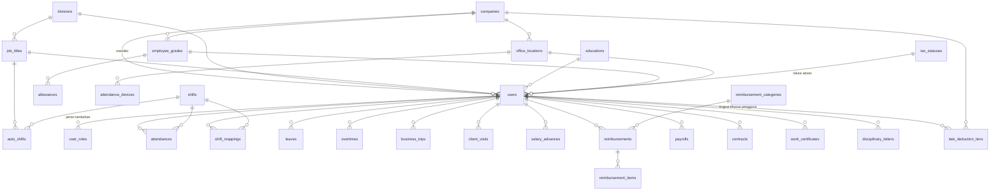

# Model Data

Dokumen ini memetakan basis data IBE HRIS: tabel inti SDM secara rinci, lalu katalog tabel modul lain per domain. Sumbernya adalah 214 berkas di `backend/database/migrations/`, `$fillable` pada model Eloquent, dan kode service. Skema yang berlaku di server tetap ditentukan oleh migrasi yang sudah dijalankan di sana. Gambaran lapisan aplikasi ada di [ARCHITECTURE.md](ARCHITECTURE.md).

> **Cara paling andal melihat skema aktual** di laptop: jalankan `php artisan migrate` lalu `php artisan db:table users` (atau `php artisan model:show User`). Dokumen ini adalah peta, bukan pengganti perintah itu. Banyak kolom ditambahkan lewat migrasi `add_*` dan `extend_*` setelah tabelnya dibuat.

## 1. Konvensi

| Hal | Aturan di proyek ini |
|---|---|
| Tenant | Kolom `company_id` menunjuk ke `companies.id`. Baris dengan `company_id` kosong adalah data global yang terlihat semua tenant (`CompanyScope`). |
| Kunci utama | `users.id` adalah **ULID** (26 karakter). Hampir semua tabel lain memakai `bigint` auto-increment. Beberapa tabel RBAC baru (`rbac_user_assignments`, `rbac_delegations`, `rbac_access_decisions`) juga memakai ULID sebagai kunci utama. |
| Referensi ke pengguna | Kolom seperti `user_id`, `approved_by`, `granted_by` bertipe `char(26)` atau `foreignUlid`. Untuk relasi baru ke `users`, pakai `foreignUlid`. |
| Foreign key | Banyak relasi hanya berupa kolom tanpa batasan di database. Integritas dijaga kode. Jangan mengandalkan `ON DELETE CASCADE` kecuali migrasinya menyatakannya (misalnya `leaves.user_id`). |
| Waktu | `created_at`/`updated_at` di hampir semua tabel. `SoftDeletes` (`deleted_at`) dipakai di modul CRM, produk, BOM, PO, gudang, dan dokumen perusahaan. |
| Uang | Bilangan bulat rupiah (`unsignedBigInteger`/`bigInteger`), bukan desimal. Pengecualian: tabel keuangan dan multi-mata-uang memakai kolom `currency` dan `decimal`. |
| Enum | Banyak kolom status memakai `ENUM` di MySQL/MariaDB. Di SQLite lokal, perubahan ENUM dilewati, sehingga nilai tidak divalidasi oleh database. |
| Berkas | Kolom `*_path` menyimpan lokasi di penyimpanan privat, dengan pasangan `*_sha256`, `*_size_bytes`, `*_mime_type` untuk integritas. |
| Penomoran dokumen | `document_counters` dan `letter_categories.last_seq_*` menghasilkan nomor berurutan per perusahaan dan tahun. |

## 2. Diagram relasi SDM inti

## 3. Tabel inti SDM

### 3.1 `companies` (tenant)

Perusahaan sebagai batas data. Kolom utama: `name`, `slug`, `logo`, `address`, `city`, `phone`, `email`, `is_active`. Migrasi berikutnya menambah alamat rinci, `npwp`, stempel dan tanda tangan (`finance_signature_path`, `hrd_signature_path`), pengaturan merek, pengaturan tanda air, dan aturan absensi dari kontrak kerja: `late_grace_default_minutes`, `attendance_bonus_min_present`, `attendance_bonus_max_late`.

### 3.2 `users` (karyawan sekaligus akun login)

Satu tabel menyimpan identitas, data kepegawaian, tarif gaji, dan data wajah. Kolom utama menurut `$fillable` model:

| Kelompok | Kolom |
|---|---|
| Identitas dan login | `id` (ULID), `company_id`, `nip`, `employee_number`, `name`, `email`, `legacy_email`, `phone`, `password`, `group`, `npwp`, `ktp_number` |
| Pribadi | `gender`, `marital_status`, `birth_date`, `birth_place`, `address`, `city`, `province`, `regency`, `district`, `village`, `postal_code`, `profile_photo_path` |
| Organisasi | `division_id`, `job_title_id`, `education_id`, `employee_grade_id`, `tax_status_id`, `office_location_id`, `default_shift_id`, `join_date` |
| Kepegawaian | `employment_status`, `training_started_at`, `training_ends_at`, `training_review_status`, `resigned_at`, `last_working_date`, `resignation_type`, `resignation_reason`, `resigned_by` |
| Absensi | `attendance_location_mode` (`office_geofence` atau `mobile_field`), `face_descriptor`, `face_descriptor_pending`, `face_photo`, `face_photo_pending`, `face_quality_pending` |
| Gaji dan tarif | `salary_monthly`, `daily_rate`, `meal_transport_rate`, `overtime_rate`, `attendance_allowance`, `late_deduction`, `absent_deduction`, `leave_deduction`, `bonus_rate`, `thr_allowance`, `salary_advance_balance`, `annual_leave_balance`, `bank_account` |
| Keamanan | `two_factor_*` (Fortify), `invite_token`, `invite_token_expires_at`, `invite_accepted_at`, `mailbox_password_encrypted` |
| Tanda tangan | `director_signature_path`, `finance_signature_path`, `hrd_signature_path` |

Nilai penting:

- `group`: `user`, `admin`, `superadmin`, `finance`, `produksi`, `direktur`, `marketing`.
- `employment_status`: `permanent`, `probation`, `training`, `intern_campus`, `intern_hub`, `pkl_smk`, `resigned`, `terminated`. Akun dengan status `resigned`/`terminated`, `resigned_at` terisi, atau training yang menunggu tinjauan (`training_review_status = pending_review`) dianggap **tidak aktif** dan ditolak masuk.
- Kolom `face_descriptor*`, `password`, `mailbox_password_encrypted`, `invite_token`, dan rahasia 2FA masuk daftar `$hidden`, sehingga tidak ikut serialisasi JSON.
- Migrasi awal pernah membuat kolom `raw_password`. Kolom itu sudah dihapus oleh migrasi `drop_raw_password_from_users` (26 Apr 2026), dan uji `EmployeeApiTest` memastikan API tidak mengembalikannya. Kata sandi tidak boleh disimpan dalam bentuk apa pun selain hash. Perintah impor lama `MigrateOldDatabase` masih menyebut kolom ini, tetapi hanya mengisinya bila kolomnya ada.

### 3.3 Peran tambahan

`user_roles(user_id, role, is_primary, granted_by, notes, granted_at)` menyimpan peran selain `users.group`. Peran utama tidak bisa dicabut lewat tabel ini; ubah `users.group`.

### 3.4 Master data

| Tabel | Isi |
|---|---|
| `divisions` | Divisi, termasuk `default_shift_id`. |
| `job_titles` | Jabatan, terkait `division_id`. |
| `educations` | Jenjang pendidikan. Data global. |
| `employee_grades`, `allowances` | Golongan dan tunjangan makan serta transport per golongan. |
| `tax_statuses` | Status PTKP (`ptkp_current`, `ptkp_2015`, `ptkp_2009`). |
| `office_locations` | Lokasi kantor: `latitude`, `longitude`, `radius_meters`, `is_active`. Dasar geofence. |
| `holidays`, `leave_holidays` | Hari libur nasional dan cuti bersama. |

### 3.5 Absensi

**`shifts`**: `name`, `start_time`, `end_time`, `grace_period_minutes`.
**`shift_mappings`**: jadwal harian `(company_id, user_id, shift_id, date)`.
**`auto_shifts`**: shift bawaan per jabatan `(job_title_id, shift_id)`.

**`attendances`**: satu baris per absen masuk.

| Kolom | Keterangan |
|---|---|
| `user_id`, `date`, `shift_id` | Siapa, tanggal, shift yang dipakai. |
| `time_in`, `time_out` | Jam masuk dan keluar. |
| `status` | `present`, `late`, `excused`, `sick`, `absent`, `off_shift`. |
| `late_minutes` | Menit terlambat dihitung dari jam mulai shift. |
| `latitude`, `longitude`, `location_policy` | Koordinat dan kebijakan lokasi (`office_geofence`/`mobile_field`). |
| `selfie_in_*`, `selfie_out_*` | Jalur berkas privat, checksum, ukuran, dimensi, koordinat, akurasi, waktu pengambilan, alamat, dan `*_location_risk_flags` untuk masing-masing selfie. |
| `face_check_in`, `face_check_out` | JSON hasil verifikasi wajah: kecocokan, skor liveness dan antispoof, jumlah wajah, tanda tinjauan. Tidak memuat data biometrik mentah. Absen sebelum 19 Okt 2026 bernilai null. |
| `attendance_device_id`, `barcode_id` | Perangkat penanda dan referensi barcode lama. |
| `note`, `attachment*` | Keterangan dan lampiran (izin atau sakit). |

**`attendance_devices`**: mesin absensi (merek, nomor seri, IP, status sinkron, rahasia push) yang mengirim data ke `/hardware/push`.
**`barcodes`**: kode barcode absensi lama, masih ada sebagai tabel pendukung.

### 3.6 Cuti, lembur, perjalanan, kunjungan

| Tabel | Kolom utama | Status |
|---|---|---|
| `leaves` | `leave_type` (`annual`, `sick`, `personal`, `medical_checkup`, `other`), `start_date`, `end_date`, `days_count`, `reason`, `attachment`, `approved_by`, `approved_at` | `pending`, `approved`, `rejected`, `cancelled` |
| `leave_quotas` | Kuota per tahun: cuti tahunan, sakit, pribadi, dan lain-lain | |
| `leave_policy_globals` | Kebijakan: carry-over, batas carry, persetujuan otomatis | |
| `leave_policy_quotas` | Kuota per jenis cuti menurut status kepegawaian (`permanent`, `contract`, `intern`) | |
| `overtimes` | Bukti masuk dan pulang lembur (waktu, koordinat, jarak, foto), `total_hours`, `reason` | `pending`, `approved`, `rejected` |
| `business_trips` | Perjalanan dinas: `shift_id`, bukti masuk dan pulang, `late_minutes`, `early_out_minutes`, `destination`, `purpose` | `pending`, `approved`, `rejected` |
| `client_visits` | Kunjungan klien: `visit_in`/`visit_out`, foto, koordinat, catatan | `ongoing`, `completed` |

### 3.7 Kasbon, reimbursement, payroll

- **`salary_advances`** (kasbon): `date`, `amount`, `purpose`. Alur dua tahap: `pending` → `approved` (HR) → `paid` (Finance); `rejected` untuk penolakan. Migrasi lanjutan menambah kolom persetujuan HR dan tertaut ke jurnal.
- **`reimbursements`**: `category_id`, `date`, `event`, `unit_price`, `quantity`, `total_amount`, `approved_amount`, `attachment_path`. Status berevolusi menjadi dua tahap: `pending` → `hr_approved` → `settled`, ditambah `approved` (warisan), `rejected`, `cancelled`. Tertaut ke jurnal akuntansi.
- **`reimbursement_categories`** (dengan `limit_amount` dan akun beban `expense_account_id` ke `fin_accounts`) dan **`reimbursement_items`** (rincian per baris).
- **`payrolls`**: satu baris per karyawan per periode (`month`, `year`, `period_start`, `period_end`, `payroll_number`). Berisi rekap kehadiran dan, untuk setiap komponen, tiga angka `*_count`, `*_rate`, `*_total` (lembur, kehadiran, bonus, THR, terlambat, tidak hadir, cuti), ditambah `base_salary`, `meal_transport_total`, `reimbursement_total`, `salary_advance_balance`, `salary_advance_payment`, `gross_total`, `deduction_total`, `net_total`, dan bukti transfer (`transfer_proof_path`, `transfer_reference`). Status: `draft` → `submitted` → `approved` → `paid`.
- **`payroll_formula_components`**: komponen rumus gaji yang dapat diatur (`formula`, `method`, `taxable`, `sort_order`), dihitung oleh `PayrollFormulaEvaluator`.
- **`late_deduction_tiers`**: potongan keterlambatan bertingkat (`min_minutes`, `max_minutes`, `deduction_amount`), bisa khusus satu pengguna (`user_id`).

### 3.8 Dokumen kepegawaian

| Tabel | Isi |
|---|---|
| `contract_templates`, `contract_template_versions` | Templat kontrak per `employment_type`, berversi, dari HTML atau DOCX. |
| `contracts` | Kontrak kerja per karyawan: nomor, `placeholders` (JSON), tanda tangan, PDF bertanda tangan, IP penandatangan, materai. Status awal `pending_signature`, `signed`, `voided`; alur multi-penandatangan menambah kolom lanjutan. |
| `work_certificates` | Surat keterangan kerja: nomor, penandatangan, PDF, `verification_hash` untuk verifikasi publik di `/verify/skk/{hash}`. |
| `disciplinary_letters` | Surat peringatan dengan `expiry_date`. |
| `documents` | Dokumen karyawan umum (`document_type`, `file_path`). |
| `email_migration_invites` | Undangan klaim email `@ibereality.com`. |

## 4. Hak akses, lisensi, dan keamanan

| Tabel | Fungsi |
|---|---|
| `rbac_roles`, `rbac_capabilities`, `rbac_role_capability` | Peran, kapabilitas, dan pemetaannya per perusahaan (RBAC enterprise). |
| `rbac_user_assignments`, `rbac_assignment_scopes` | Penugasan peran ke pengguna dengan masa berlaku, cakupan, dan batas persetujuan. |
| `rbac_delegations` | Delegasi kapabilitas dengan batas persetujuan dan masa berlaku. |
| `rbac_access_decisions` | Jejak keputusan otorisasi (mode shadow/enforce) untuk membandingkan sistem lama dan baru. |
| `saas_plans`, `saas_plan_modules` | Paket langganan dan modul di dalamnya. |
| `company_subscriptions`, `company_module_entitlements` | Langganan perusahaan dan modul yang aktif, termasuk batas dan masa berlaku. |
| `personal_access_tokens` | Token Sanctum. |
| `refresh_tokens` | Token refresh berotasi: `token_hash`, `used_at`, `replaced_by_id`, IP, agen pengguna. |
| `sso_tokens` | Tiket SSO sekali pakai (dibersihkan harian). |
| `sessions`, `password_reset_tokens` | Sesi dan reset sandi bawaan Laravel. |
| `audit_logs` | `actor_id`, `action`, `entity_type`, `entity_id`, `meta`, IP, agen pengguna. Tidak dipangkas otomatis. |
| `api_idempotency_keys` | Kunci idempoten (24 jam): hash permintaan, status, respons tersimpan. |
| `webhook_endpoints`, `webhook_events`, `webhook_deliveries` | Webhook keluar, peristiwa, dan percobaan pengiriman. |

## 5. Modul lain (katalog)

Bagian ini mendaftar tabel per domain agar mudah dicari. Rincian kolom dapat dilihat lewat `php artisan db:table <nama>`.

| Domain | Tabel |
|---|---|
| **Keuangan** (`app/Keuangan`) | `fin_accounts` (bagan akun berjenjang), `fin_journals`, `fin_journal_lines` (jurnal berpasangan debit–kredit), `fin_customers`, `fin_suppliers`, `fin_invoices`, `fin_invoice_lines`, `fin_bills`, `fin_bill_lines`, `currencies`, `exchange_rates` |
| **Treasury** | `treasury_bank_accounts`, `treasury_payments` (maker–checker: `maker_id`, `approved_by`, `executed_by`), `treasury_cash_transactions`, `bank_statements`, `company_banks` |
| **CRM** (`app/Marketing`) | `crm_companies`, `crm_contacts`, `crm_leads`, `crm_pipelines`, `crm_stages`, `crm_deals`, `crm_activities`, `crm_tasks`, `crm_lead_forms`, `crm_lead_form_submissions`, `crm_campaigns`, `crm_campaign_recipients`, `crm_email_suppressions` |
| **Penjualan** | `quotations`, `quotation_items`, `quotation_templates`, `sales_orders`, `sales_order_lines`, `sales_payment_allocations`, `sales_returns`, `customer_surveys`, `complaints`, `service_ticket_activities` |
| **Pengadaan** | `purchase_requests`, `procurement_rfqs`, `purchase_orders`, `purchase_order_lines`, `vendors`, `vendor_access_tokens` |
| **Produk dan produksi** (`app/Production`, `app/Produksi`) | `products`, `product_spec_fields`, `product_serial_numbers`, `boms`, `bom_components`, `work_orders`, `work_order_components`, `work_order_outputs`, `quality_inspections`, `vendor_work_orders`, `work_order_progress` |
| **Gudang dan aset** (`app/Warehouse`) | `inventory_warehouses`, `inventory_stock`, `inventory_batches`, `inventory_batch_stock`, `inventory_movements`, `stock_counts`, `stock_count_lines`, `inventories`, `inventory_categories`, `fixed_assets`, `fixed_asset_depreciations`, `maintenance_schedules`, `maintenance_logs` |
| **Distribusi** | `shipments`, `shipment_items`, `delivery_fleets`, `delivery_returns` |
| **Persuratan** (`app/Surat`) | `letters` (nomor, subjek, badan HTML, penerima, penandatangan, surat induk), `letter_categories`, `letter_templates`, `letter_signatures`, `letter_dispositions`, `letter_revisions`, `letter_attachments`, `letter_settings` |
| **Proyek** | `projects`, `project_members` (peran `owner`, `lead`, `member`, `viewer`), `tasks`, `task_comments`, `task_attachments`, `task_activities`, `task_dependencies`, `task_assignments`, `task_assignment_items`, `task_label`, `labels`, `sprints`, `goals`, `okrs`, `project_notifications` |
| **Anggaran proyek** | `project_budgets`, `project_budget_items`, `project_budget_versions`, `project_budget_audits`, `project_progress_entries` |
| **Kinerja dan talenta** | `performance_types`, `performance_reports`, `performance_reviews`, `nine_box_ratings`, `job_postings`, `candidates`, `courses`, `enrollments`, `certificates`, `meetings`, `meeting_participants`, `meeting_minutes` |
| **Tata kelola** | `governance_records`, `approval_requests`, `workflow_definitions`, `workflow_steps`, `company_documents`, `documents`, `document_versions`, `document_counters` |
| **Komunikasi** | `broadcasts`, `broadcast_recipients`, `app_notifications`, `notification_templates`, `web_push_subscriptions`, `scheduled_emails`, `shared_mailboxes`, `webmail_gateway_sessions`, `webmail_sso_tickets`, `webmail_inbox_state` |
| **Konfigurasi** | `company_themes`, `integrations` (kredensial terenkripsi), `backup_configs`, `backup_snapshots` |
| **Infrastruktur Laravel** | `jobs`, `job_batches`, `failed_jobs`, `cache`, `cache_locks`, `sessions` |

Beberapa alur lintas-modul menghubungkan tabel lewat kolom referensi, misalnya `crm_deals.fin_invoice_id` (deal menang membuat faktur), `purchase_orders.fin_bill_id`, `reimbursements`/`salary_advances`/`payrolls` yang tertaut ke `fin_journals`, dan `sales_orders.quotation_id`.

## 6. Klasifikasi data sensitif

Gunakan ini sebagai daftar periksa ketika membuat fitur baru, mengekspor data, atau menulis log.

| Kategori | Kolom atau tabel | Perlakuan |
|---|---|---|
| **Biometrik** | `users.face_descriptor`, `face_descriptor_pending`, `face_photo*`, foto wajah di penyimpanan privat | Tidak pernah dikirim ke klien (`$hidden`), tidak masuk log, hanya diakses lewat URL bertanda tangan berumur pendek. Pendaftaran wajib disetujui admin. |
| **Identitas** | `ktp_number`, `npwp`, `birth_date`, alamat, nomor HP | Tampilkan seperlunya; audit akses oleh admin. |
| **Keuangan pribadi** | `salary_monthly`, `daily_rate`, tarif, `bank_account`, seluruh `payrolls`, `salary_advances`, bukti transfer | Hanya peran dengan kapabilitas payroll; pemisahan HR (mengajukan) dan Finance (menyetujui, membayar). |
| **Kredensial** | `password`, `invite_token`, `mailbox_password_encrypted`, rahasia 2FA, `refresh_tokens.token_hash`, `integrations.credential_encrypted`, `webhook_endpoints.secret` | Disimpan sebagai hash atau terenkripsi; jangan di-log dan jangan dikembalikan oleh API. |
| **Bukti lokasi** | Koordinat dan alamat di `attendances`, `overtimes`, `business_trips`, `client_visits` | Pakai hanya untuk validasi kehadiran. |

## 7. Menambah atau mengubah skema

1. Buat migrasi baru: `php artisan make:migration add_xxx_to_yyy_table`. Jangan mengedit migrasi lama yang sudah berjalan di server.
2. Tabel bertenant: tambahkan `company_id` dan, pada model, pakai `BelongsToCompany` agar `CompanyScope` aktif.
3. Referensi ke pengguna memakai `foreignUlid('user_id')`.
4. Bila mengubah ENUM, ikuti pola `if (DB::getDriverName() !== 'sqlite')` seperti di `add_off_shift_to_attendances_status`, sediakan `down()` yang aman, dan uji di MySQL/MariaDB.
5. Tambahkan kolom baru ke `$fillable` (dan `$hidden` bila sensitif) pada modelnya, lalu ke `Resource` bila perlu terlihat di API.
6. Perbarui factory dan seeder bila diperlukan, tulis uji di `tests/Feature/Api/`, lalu jalankan suite (lihat README, bagian uji otomatis).
7. Perbarui dokumen ini bila tabel atau status penting berubah.
